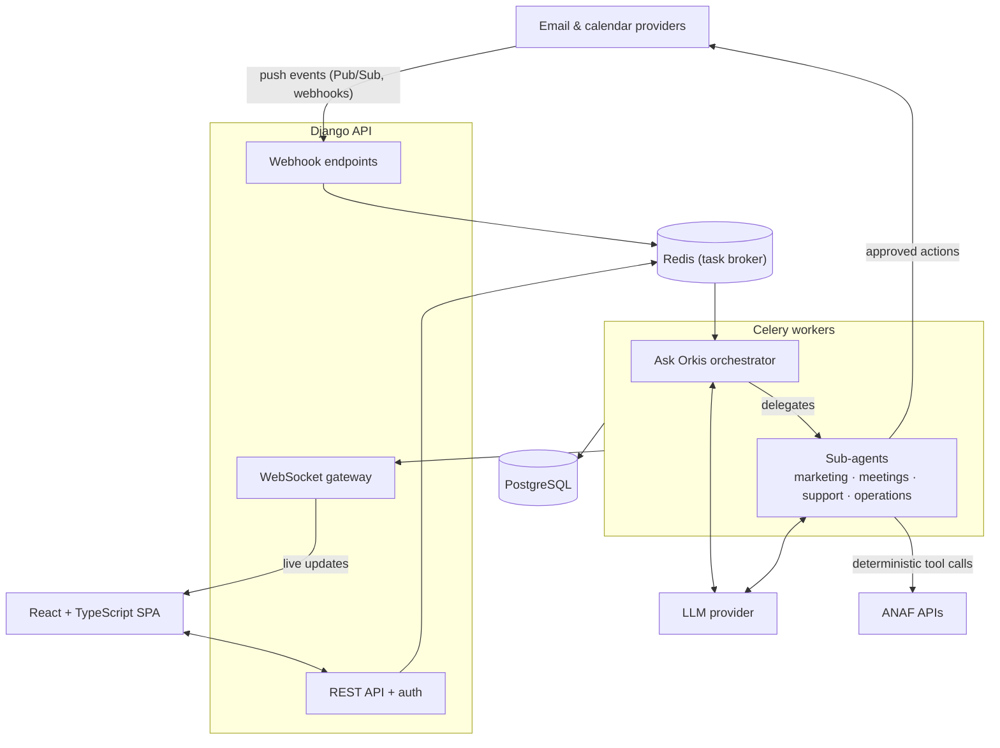

# Orkis — No-Code AI Agent Platform for Business Workflows

> Configurable AI agents that run real business workflows — with permissions, approvals and deterministic integrations, without writing code.
>
> 🌐 [orkis.ro](https://orkis.ro)

<!-- SCREENSHOT: presentation website (landing page) -->

---

## Overview

Orkis is a multi-tenant B2B SaaS that turns AI agents into practical, permissioned business workflows. Companies start from ready-made agent templates for everyday operations and customize each agent with their own rules, tools, data sources and allowed actions — all through a no-code interface.

At the center is **Ask Orkis**, a business agent that understands the user's context, answers questions and coordinates four specialized sub-agents. Non-invasive work, like automatic summaries, runs end-to-end on its own. Invasive actions stay pending until the user approves or rejects them.

---

## Product tour

### Dashboard — what needs your attention

<!-- SCREENSHOT: dashboard with pending agent actions and priority items -->

- **Pending actions** proposed by agents, waiting for the user to approve or reject them
- Priority items: VIP senders, urgent emails, upcoming meetings
- Live updates pushed from background workers over WebSockets

### Invoice processing with Ask Orkis

<!-- SCREENSHOT: opened invoice + Ask Orkis side panel -->

- Invoice data is extracted and verified, including **ANAF company and VAT status checks**
- The user can ask Orkis about the open document ("Is this supplier VAT-registered?", "Does this match last month's invoice?")
- Fiscal checks run as deterministic tool calls — the model reports the result, it never decides it

### Configurable agent templates

<!-- SCREENSHOT: agent templates / configuration page -->

Each agent is configured per company, without code:

| Setting | What it controls |
|---|---|
| Instructions & business rules | How the agent reasons and what it prioritizes |
| Tools | Which capabilities the agent may call |
| Data sources | Which inboxes, calendars and business data it can access |
| Allowed actions | What it may do automatically and what requires approval |

---

## Agents

| Agent | Responsibilities |
|---|---|
| **Ask Orkis** | Central agent: understands user context, answers questions, delegates to sub-agents |
| **Marketing** | CMO and marketing reports generated from connected business data |
| **Meeting preparation** | Prepares meetings using inbox, calendar and business context |
| **Customer support** | Priority handling, VIP sender detection, AI-generated reply suggestions |
| **Business operations** | Invoice verification and processing, ANAF company and VAT checks |

---

## Architecture

### Event-driven pipeline

1. An email or calendar provider sends a push event (Pub/Sub / webhook).
2. The webhook endpoint validates the event and enqueues a task — no LLM work happens in the request cycle.
3. A Celery worker picks up the task. Workers combine deterministic processing (fetching data, validation, ANAF checks, priority rules) with LLM steps (understanding, extraction, drafting).
4. The responsible agent runs a tool-calling loop using only the tools its template allows.
5. The outcome depends on the type of action:
   - **Non-invasive** actions, such as automatic summaries, run all the way to completion.
   - **Invasive** actions, such as sending a reply, become **pending actions** and wait until the user approves or rejects them.
6. Results are pushed to the user's dashboard in real time over WebSockets.

---

## Engineering highlights

- **Tool-calling agents with scoped tool registries** — each agent only sees the tools its configuration grants.
- **Reusable agent capabilities** — tools and skills are shared across agents and composed per template.
- **Deterministic where it matters** — the LLM handles understanding and extraction; company and VAT checks against ANAF run as plain code.
- **Permissioned automation** — allowed actions are configured per agent. Non-invasive actions run automatically, invasive ones wait for human approval.
- **Distributed workers** — Celery + Redis run both LLM reasoning and deterministic processing off the request path.
- **Multi-tenant governance** — company data, agent configurations and permissions are isolated per tenant.

---

## Tech stack

| Layer | Technologies |
|---|---|
| Frontend | React, TypeScript |
| Backend | Python, Django, WebSockets |
| Async & events | Celery, Redis, Pub/Sub, webhooks |
| Data | PostgreSQL, Redis |
| AI | LLM applications, tool calling, multi-agent orchestration |
| Integrations | Email & calendar APIs, ANAF APIs |
| Infrastructure | Docker |

---

> **Source code is private** (commercial project). Happy to do a live architecture and code walkthrough on request — [LinkedIn](https://www.linkedin.com/in/rares-popa-5427b22a8/).
